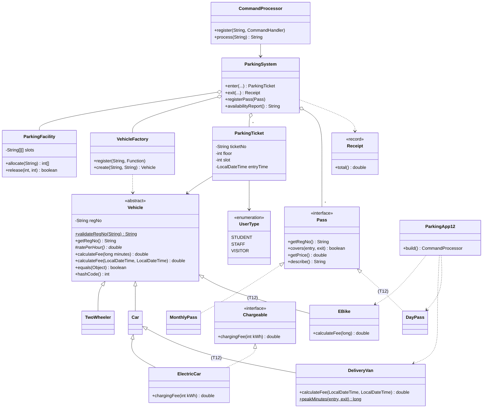

# System UML Class Diagram (Tasks 11 and 12)

Classes marked *(T12)* were added in Task 12; all others are unchanged from Task 11.

Vehicle hierarchy only (Task 6): see `../Task06_Inheritance/UML_Diagram.md` (includes a plain-text version).
