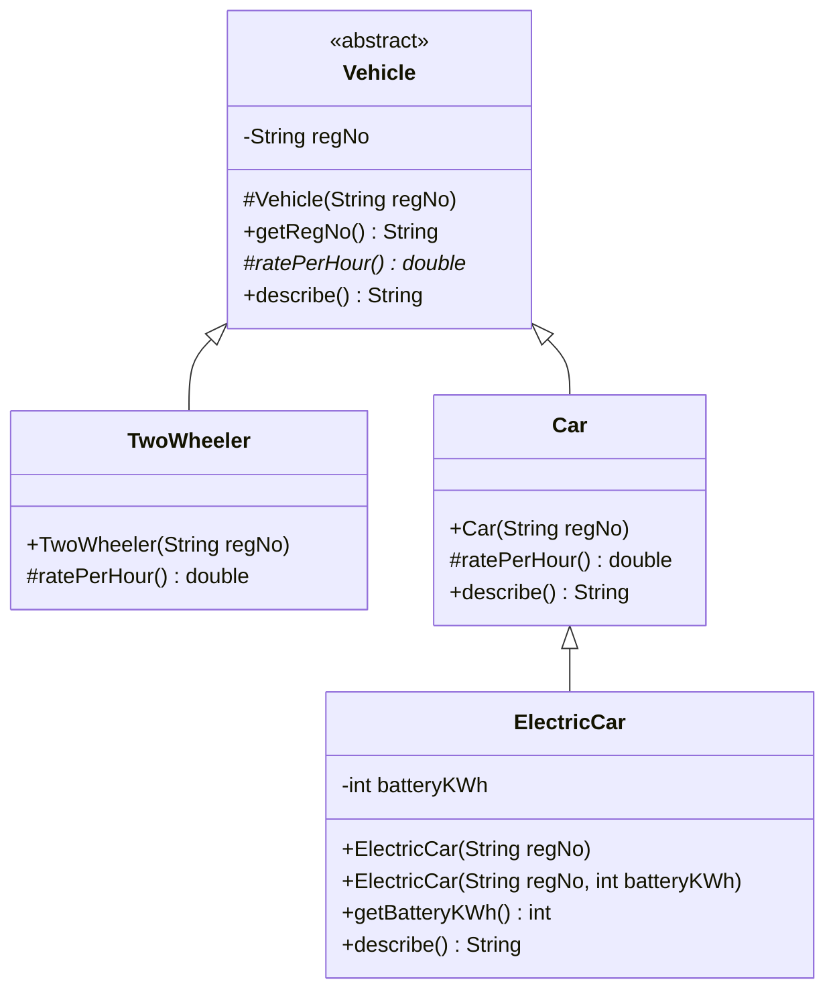

# Task 6 – UML Class Diagram (vehicle hierarchy)

## Mermaid version (renders on GitHub and in VS Code with a Mermaid extension)



## Text version (always readable)

```
                +-----------------------------+
                |     <<abstract>> Vehicle    |
                |-----------------------------|
                | -regNo : String             |
                |-----------------------------|
                | #Vehicle(regNo)             |
                | +getRegNo() : String        |
                | #ratePerHour() : double {abstract}
                | +describe() : String        |
                +--------------^--------------+
                               |
              +----------------+----------------+
              |                                 |
   +----------+-----------+         +-----------+-----------+
   |      TwoWheeler      |         |          Car          |
   |----------------------|         |-----------------------|
   | +TwoWheeler(regNo)   |         | +Car(regNo)           |
   | #ratePerHour() = 10  |         | #ratePerHour() = 30   |
   +----------------------+         | +describe()           |
                                    +-----------^-----------+
                                                |
                                    +-----------+-----------+
                                    |      ElectricCar      |
                                    |-----------------------|
                                    | -batteryKWh : int     |
                                    |-----------------------|
                                    | +ElectricCar(regNo)   |
                                    | +ElectricCar(regNo,kWh)|
                                    | +getBatteryKWh()      |
                                    | +describe()           |
                                    +-----------------------+
```

Legend: `-` private, `#` protected, `+` public; hollow-arrow (`^`) = inheritance ("is-a"); `{abstract}` = abstract method.
